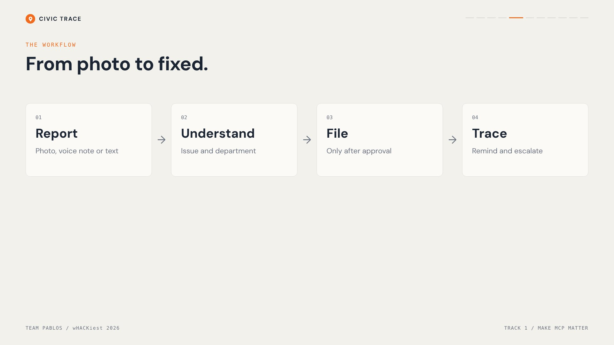
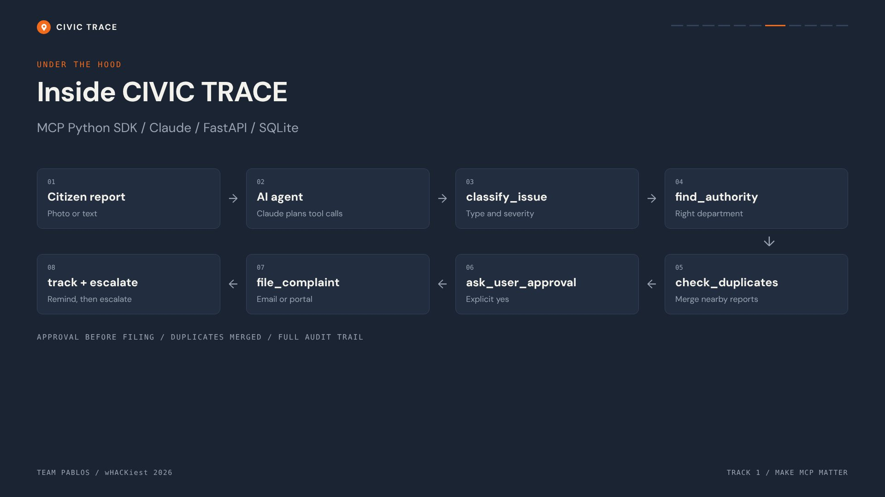
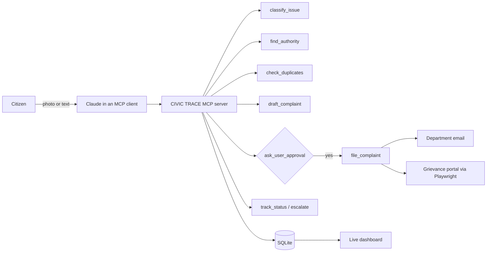
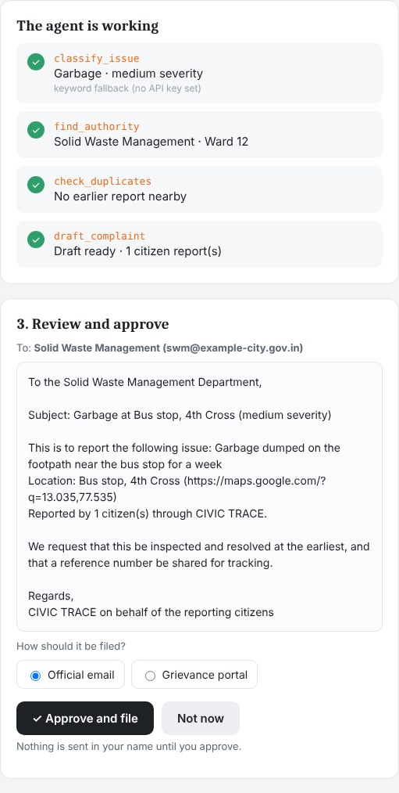
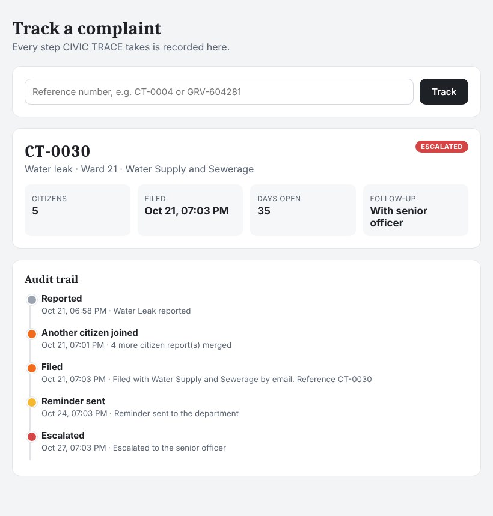
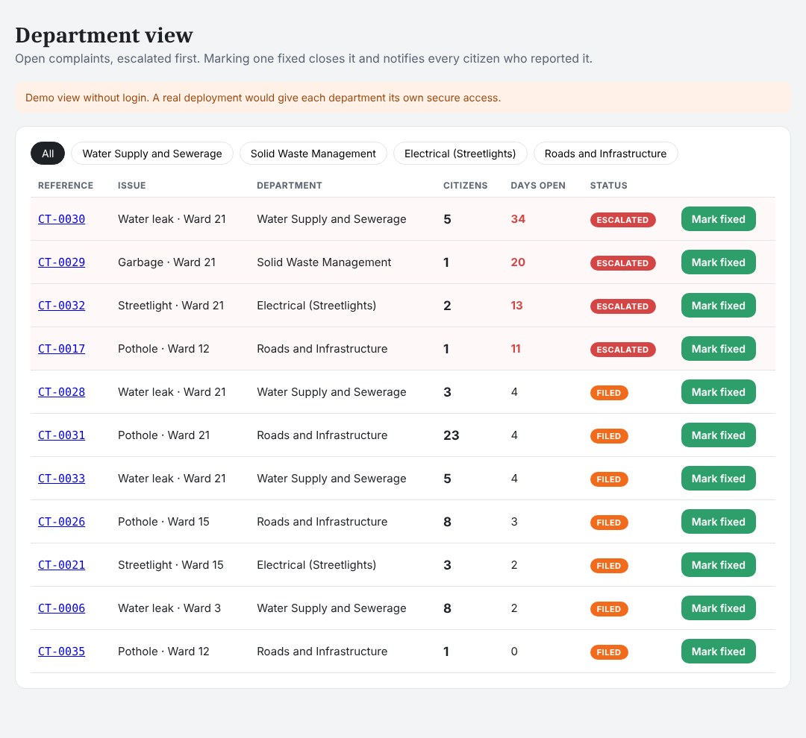

<div align="center">

# 📍 CIVIC TRACE

### Snap it. We'll chase it.

**An MCP agent that files civic complaints for citizens, and keeps following up until they're fixed.**

[](https://github.com/swayamsrathod/civic-traces/actions/workflows/tests.yml)


`wHACKiest 2026` · `Track 1 · Make MCP Matter` · **Team Pablos** · Sapthagiri NPS University

[🎥 Watch the demo video](https://youtu.be/z5lz1ieqwYc) · [📊 Pitch deck](https://docs.google.com/presentation/d/1brBCPEl5N3mpTfX9m8S3-TqRnpjeRv5Y/edit?usp=sharing)

</div>

---

## 🚧 The problem

You see a pothole, an overflowing garbage bin or a dead streetlight. You report it. Then nothing happens.

- **Routing.** Roads, water, power and garbage are different departments. Citizens have to guess.
- **Filing.** Every portal has its own login and long form.
- **Follow-up.** Once filed, complaints go silent. Reminders and escalation are left to the citizen, so most give up.

Filing a complaint takes five minutes. Getting it fixed takes persistence nobody has time for. **CIVIC TRACE is that persistence, automated.**

---

## ✨ What it does



| Step | What happens |
|---|---|
| 📸 **Report** | The citizen sends a photo or a message describing the problem, with its location. |
| 🧠 **Understand** | Claude identifies the issue and its severity, and finds the responsible department. |
| ✉️ **File** | The agent drafts a formal complaint and files it **only after the citizen approves**. |
| 🔁 **Trace** | It tracks the reference number, sends a reminder, then escalates to a senior officer if ignored. |

### What makes it different

- **🔗 Duplicate merging.** Reports of the same issue within 50 m join one complaint (haversine distance, with DBSCAN clustering for analytics). Departments get one strong case showing the full count instead of 30 duplicates.
- **📊 Accountability dashboard.** A live hotspot map and a report card for each ward: average days to fix and escalation rate.
- **🛑 Approval enforced in code.** `file_complaint` refuses to run unless `user_confirmed` is true. Nothing goes out in the citizen's name without an explicit yes.
- **⏰ Follows up on its own.** A background job checks every 30 seconds and sends due reminders and escalations, with no one having to ask.
- **🧾 Full audit trail.** Every step (reported, merged, filed, reminder, escalated, fixed, reporters notified) is logged and shown to the citizen.
- **🔌 Works without an API key.** If no Anthropic key is set, classification falls back to keyword matching, so anyone can run the full flow.

---

## 🏗️ Architecture





### MCP tools

| Tool | Purpose |
|---|---|
| `classify_issue` | Reads the photo or text and returns issue type, severity and a short description |
| `find_authority` | Maps the issue type and ward to the responsible department and contacts |
| `check_duplicates` | Finds an existing complaint for the same issue within 50 m |
| `draft_complaint` | Saves the report, merges duplicates and writes a formal complaint |
| `ask_user_approval` | Shows the draft to the citizen and asks for an explicit yes |
| `file_complaint` | Files by official email or by filling the grievance portal with Playwright |
| `track_status` | Shows status and flags complaints overdue for follow-up |
| `escalate` | First a reminder to the department, then escalation to the senior officer |

> Most civic portals have no public API, so complaints are filed by official email and by browser automation.

---

## 🌐 Try it in the browser

No Claude Desktop needed. The web app runs the same tools as the MCP agent.

| Page | What it does |
|---|---|
| **/report** | Citizen adds a photo, a description and a pin on the map. The agent's tool calls appear step by step, then the draft waits for **Approve and file**. |
| **/track** | Look up a complaint by reference number and see its full audit trail and photos. |
| **/** | Live accountability dashboard: hotspot map, ward report card, complaint feed. |
| **/department** | Open complaints, escalated first. **Mark fixed** closes one and notifies every reporter. |

| Report: agent steps and approval | Tracking: audit trail |
|---|---|
|  |  |



---

## 🚀 Quick start

**Windows:** double-click `run.bat`
**Mac / Linux:** `./run.sh`

This installs everything, loads demo complaints around Bengaluru and opens **http://localhost:8000/report**.

**Live demo tip:** set `ESCALATION_MINUTES=1` (in `.env` or your terminal) and a filed complaint gets its reminder after one minute and is escalated a minute later, so judges can watch the follow-up happen.

### Manual setup

```bash
git clone https://github.com/swayamsrathod/civic-traces.git
cd civic-traces
python -m pip install -r requirements.txt
python -m scripts.seed_demo --reset          # optional demo data
python -m uvicorn backend.main:app --reload  # open http://localhost:8000/report
```

Optional: copy `.env.example` to `.env` and add an `ANTHROPIC_API_KEY` for photo classification. For portal filing, also run `playwright install chromium` and `python -m http.server 8080 --directory demo_portal`.

### Connect the agent to Claude Desktop

Copy the block from [`claude_desktop_config.example.json`](claude_desktop_config.example.json) into your `claude_desktop_config.json`, set `cwd` to this folder, and restart Claude Desktop. Then try:

> *"Here's a photo of a pothole near Gate 2 of our college. Please report it."*

> Emails are **not sent** while `DRY_RUN=true` (the default); they're printed to the console. The contacts in `data/authorities.csv` are samples. Replace them with verified department contacts before real use.

---

## 🧪 Tests

```bash
python -m pip install pytest
pytest -q
```

30 tests cover classification, routing, duplicate merging, the approval gate, escalation, the web report flow, photo upload checks, automatic follow-ups, the department view and ward scores. They run automatically on every push through GitHub Actions.

---

## 🛠️ Tech stack

| Layer | Tools |
|---|---|
| Agent | Claude, MCP Python SDK |
| Backend | FastAPI, SQLite |
| Vision | Claude's image input (no custom training) |
| Data science | scikit-learn (DBSCAN, haversine), pandas |
| Automation | Playwright, SMTP |
| Web app | Leaflet, vanilla JavaScript (no build step) |

---

## 📁 Project structure

```
civic-traces/
├── mcp_server/          # MCP server (8 tools) and SQLite storage
├── analytics/           # Duplicate clustering and ward scores
├── automation/          # Email filing and Playwright portal filing
├── backend/             # FastAPI app, API and the automatic follow-up loop
├── dashboard/           # Web pages: report, track, dashboard, department
├── demo_portal/         # Demo copy of a city grievance portal
├── scripts/             # Demo data loader
├── data/                # Department directory (sample)
├── tests/               # pytest suite
├── docs/                # README images
├── run.bat / run.sh     # One-click start
└── claude_desktop_config.example.json
```

---

## 🗺️ Roadmap

- [x] Photo or text → classify → draft → approve → file
- [x] Duplicate merging, reminders and escalation
- [x] Live accountability dashboard
- [x] Citizen web app: report, approve, track
- [x] Automatic background follow-ups and audit trail
- [x] Department view to close complaints and notify reporters
- [x] Automated tests and CI
- [ ] Voice notes in regional languages
- [ ] WhatsApp support
- [ ] Auto-draft an RTI request when a complaint is ignored
- [ ] Verified department directories for more cities

---

## 👥 Team Pablos · Sapthagiri NPS University

| Name |
|---|
| Swayam S Rathod (Lead) |
| Trishul G Urs |
| Neeraj M |
| Yashas Gowda |

Licensed under the [MIT License](LICENSE).

<div align="center">

**Every complaint, traced.**

</div>
